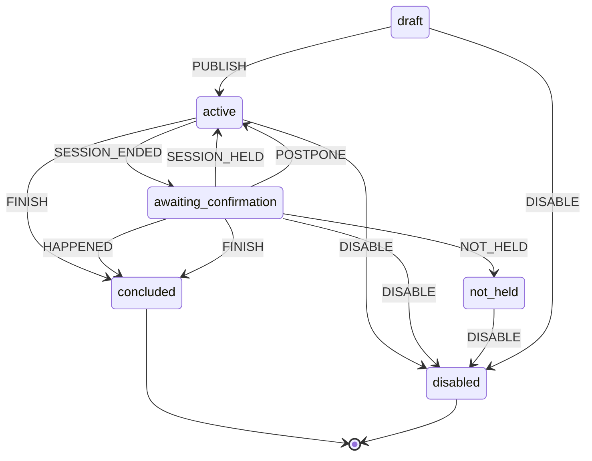
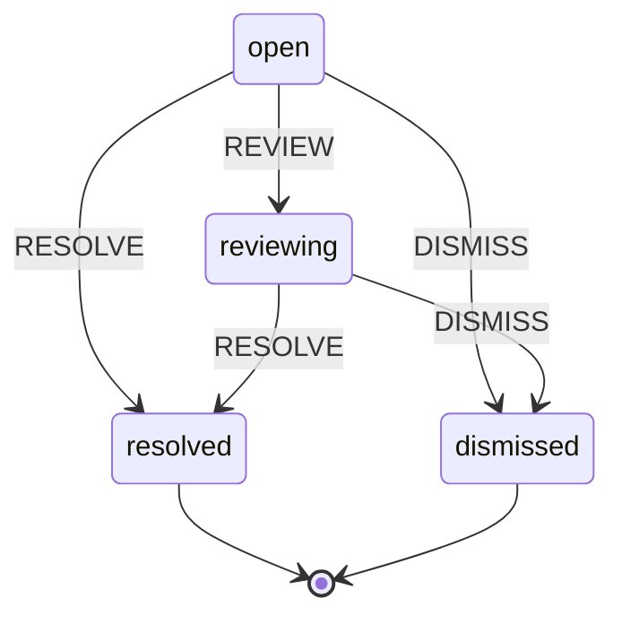
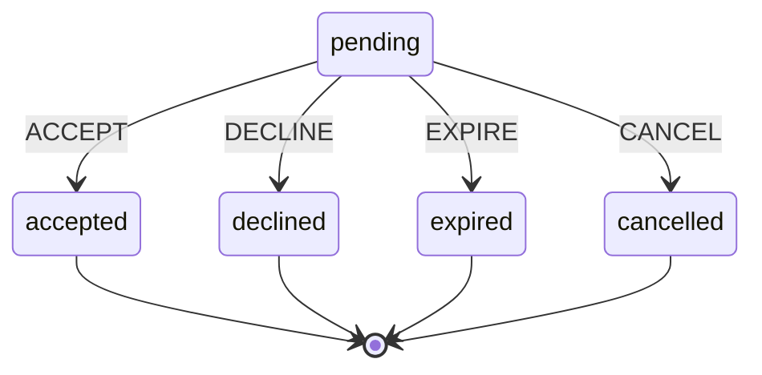
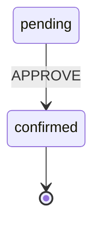
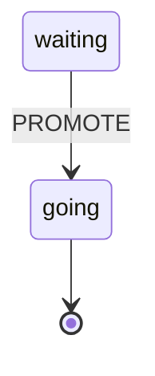

# State machines

Generated from `packages/core/src/state/machines.ts` by `machines.spec.ts`. Do not edit by hand:
change a machine, then run the spec with `UPDATE_STATE_DOCS=1` to redraw this file.

Every status is written through `applyTransition` (`packages/core/src/server/state/transition.ts`),
which asks the machine for the move and updates the row only while it is still in the status it
was read in. A move missing from a diagram is refused.

## Table (mesa)

`game_tables.status`

## Report (denúncia)

`reports.status`

## Invitation (mesa, parceiro, lugar)

`player_invitations / partner_invitations / place_host_invitations.status`

## Seat (vaga na mesa)

`registrations.status`

## Session sign-up (vaga na sessão)

`table_session_signups.status`

